# Home 3D: floor designer for Home Assistant

Draw your home, walk around it in 3D, and control your real devices from the plan. Everything runs inside Home Assistant as a dashboard in the sidebar. Install it with **HACS** in a couple of clicks; there's no add-on, nothing to copy and no coding.

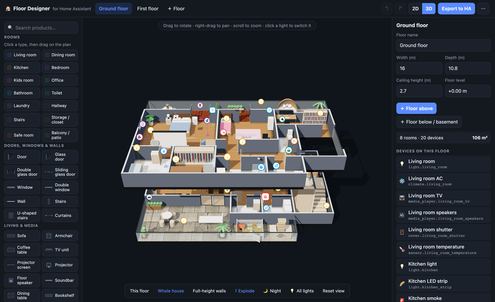

## 🆕 What's new

**Now on HACS!** [Install with HACS](#install-with-hacs-about-2-minutes) and future updates arrive as one click. **Already installed by hand?** See [Updating](#updating-to-a-new-version). Your design is kept.

- **⛶ Wall display (1.7.0).** For a tablet on the wall: **⛶ Wall** fills the whole screen with just your house, covering Home Assistant's sidebar and top bar. Add a clock (digital, analog or small), weather with a 5-day forecast for where the tablet or phone is, scene buttons, live camera pictures and any sensor values, and put each one where you like. Buttons hide by themselves, and there's a screensaver and an automatic night look. **🧹 House only** hides everything except the house. [More below](#wall-display-tablet-on-the-wall).

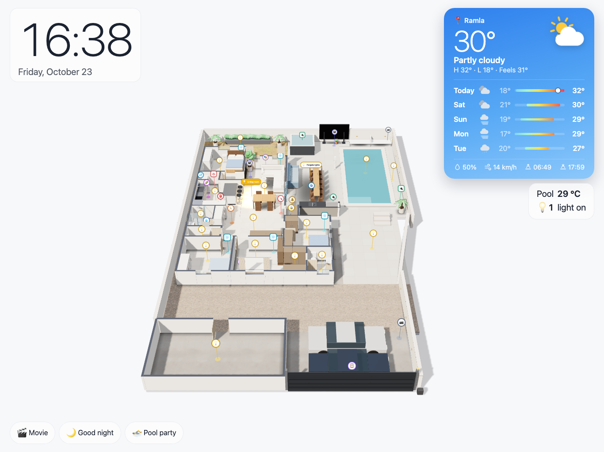

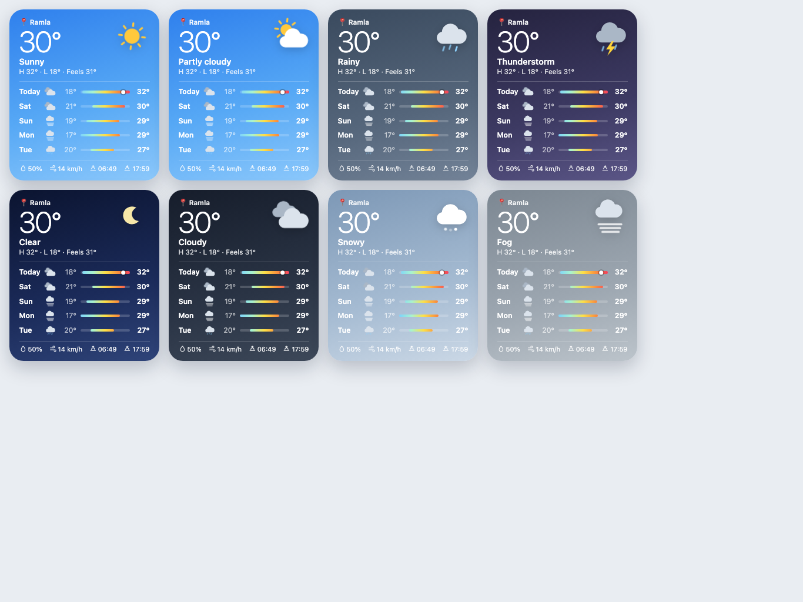

- **👆 View mode (1.5.0).** In Home Assistant it opens as just your house: rotate it and tap lights to switch them. **✏️ Edit** (top right) opens the designer.

- **🏊 Pool with electric cover, and alarm (1.4.0).** A swimming pool whose electric cover or shade screen opens and closes with the real one, plus an Alarm button.

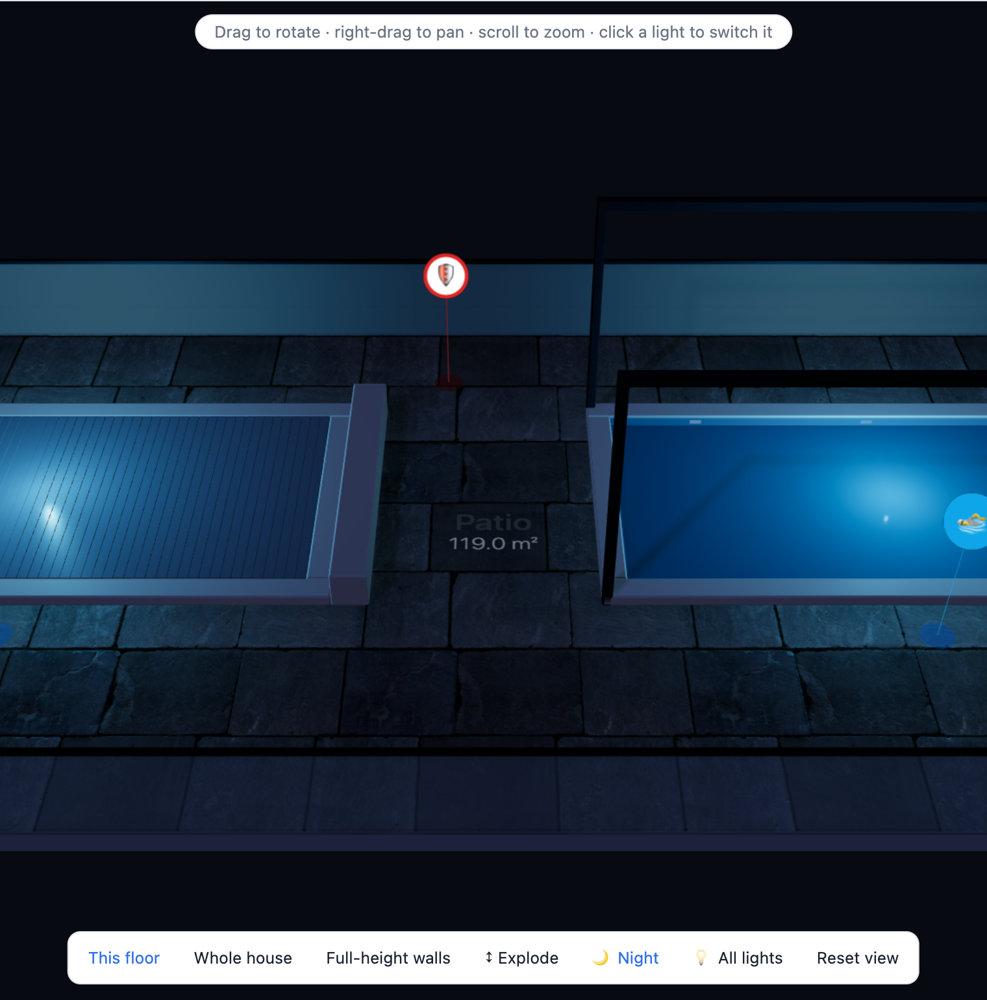

- **🚧 Electric gate (1.3.0).** Sliding, swing or garage gate that opens and closes in 3D together with your real gate in Home Assistant.

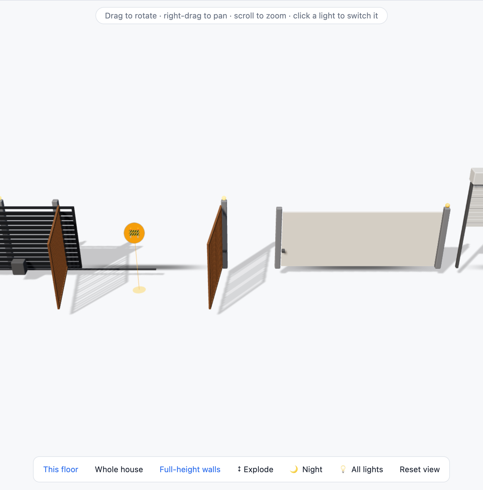

- **🍳 Kitchen and glass closet (1.2.0).** A kitchen chair with 4 legs in any colors, colors, countertops and handles for the kitchen counter and island (including a **big gold ring** handle), tall built-in kitchen cabinets with oven or fridge, and a glass closet with LED lights inside.

| Kitchen | Gold ring handles |
|---|---|
| 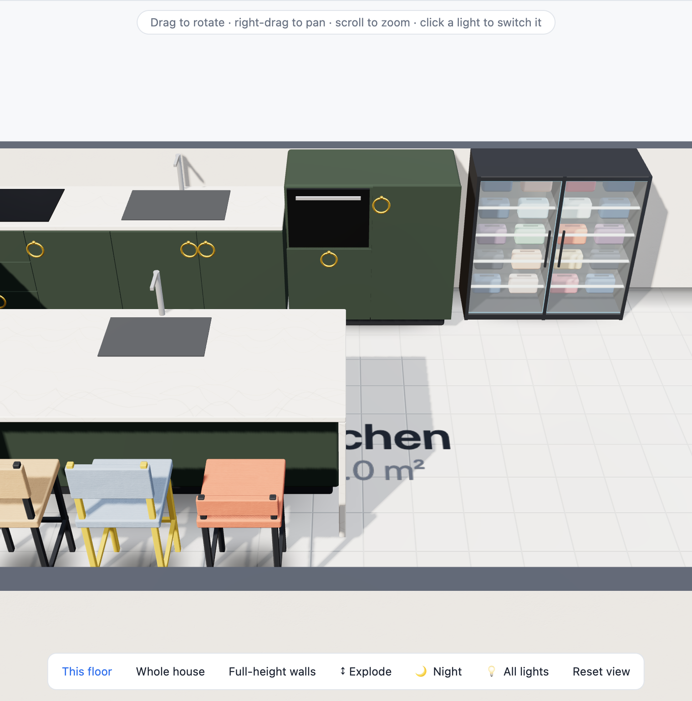 | 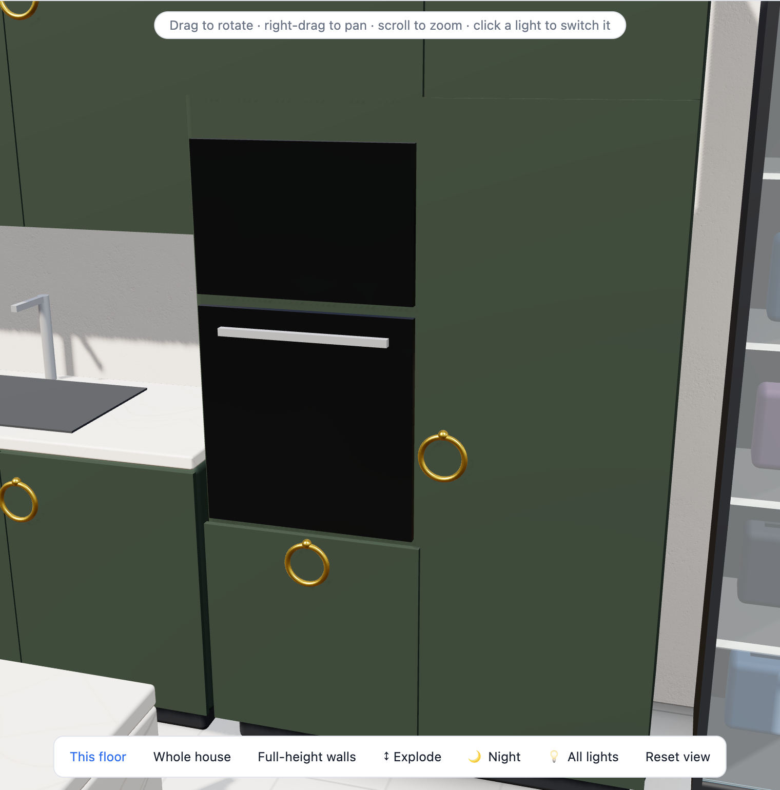 |

- **✨ Realistic 3D (1.1.0).** Real photo textures for wood floors, parquet, concrete, decking, pavers and grass, wood grain and fabric on furniture, real sky lighting, sharper sun shadows, soft shadows in the corners and under furniture, and rounded furniture edges.

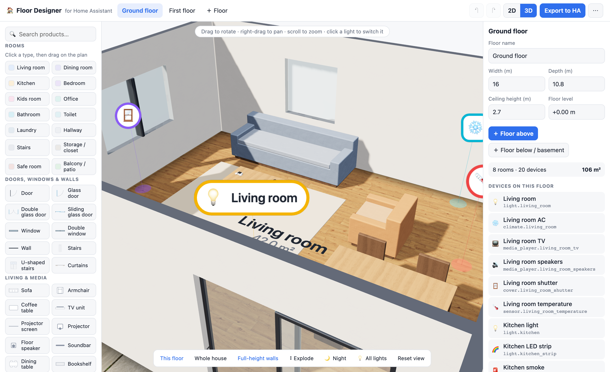

- **🪜 Stairs that connect to the floor above.** Stairs now cut a matching opening in the floor above automatically, with a glass railing around it, so they go up *through* the floor and look right in 3D. On the upper floor's 2D plan the opening shows as "↓ stairs". Don't want it? Set **Opening in the floor above → No**.
- **⬇️ Stairs going down.** Set a stair's **Direction → Down to the floor below** and it starts on the floor you're on, sinks through it and lands on the floor below (great for a basement). The floor gets the opening and railing automatically, and the floor below shows where the stairs land. In "Whole house" 3D it's one continuous staircase.
- **🔢 Choose the number of steps.** Stairs have a **Number of steps** option: *Auto* picks comfortable steps for you, or pick any number from 3 to 30. The panel shows how high each step is and warns you if they're too steep or too shallow.
- **Railing on or off.** Stairs have a **Railing** option: the handrail and the railing around the opening (default), only one of them, or no railing at all.
- **💡 LED lights on stairs.** Choose **Under each step**, **Along the bottom** or **Both**, in any color. They glow, especially in 🌙 night mode.
- **Zoom in 2D.** Scroll or pinch on the plan to zoom in on a room, and drag empty space to move around. There are also **− / + / Fit** buttons in the corner. Phones and tablets support two-finger pinch. Each floor remembers its own zoom.
- **🔍 Search products.** A search box sits above the catalog. Type `light`, `sofa`, `trash`… and only the matches show. **Enter** adds the first one, **Esc** clears.
- **💄 Makeup vanity** (Bedroom, closet & office). It has a mirror with Hollywood bulbs or an LED frame that glow in night mode, plus optional stool and drawers, in any color.
- **🗑️ Sensor trash can** (Kitchen & bath). It comes rectangular, round or as a double recycling bin, in 12 / 30 / 50 L, in steel, black or white, with a glowing blue sensor light.
- **Safer saving.** If the dashboard is edited while Home 3D is open, saving no longer overwrites that edit.

| Stairs through the floor | Stairs going down | Stair LEDs at night |
|---|---|---|
| 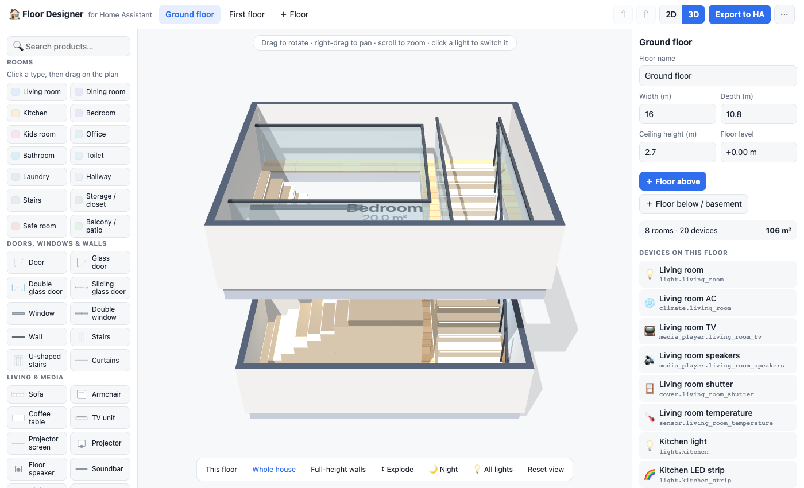 | 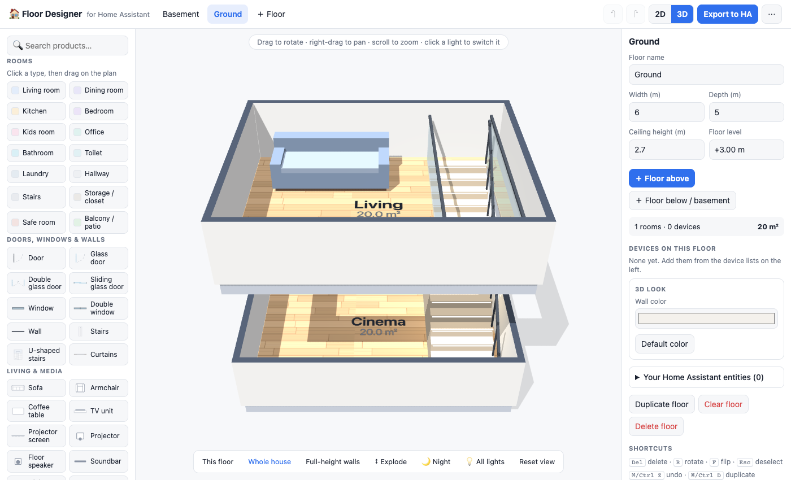 | 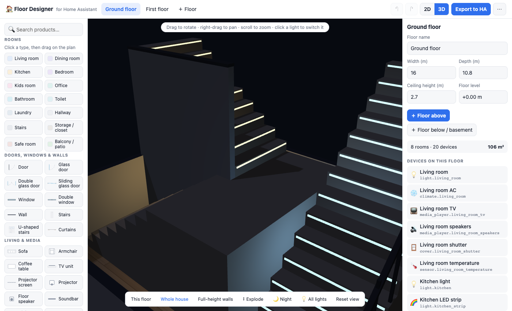 |

| Zoom + search | Vanity and trash can | …at night |
|---|---|---|
| 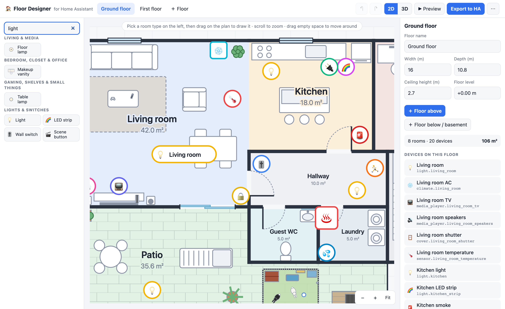 | 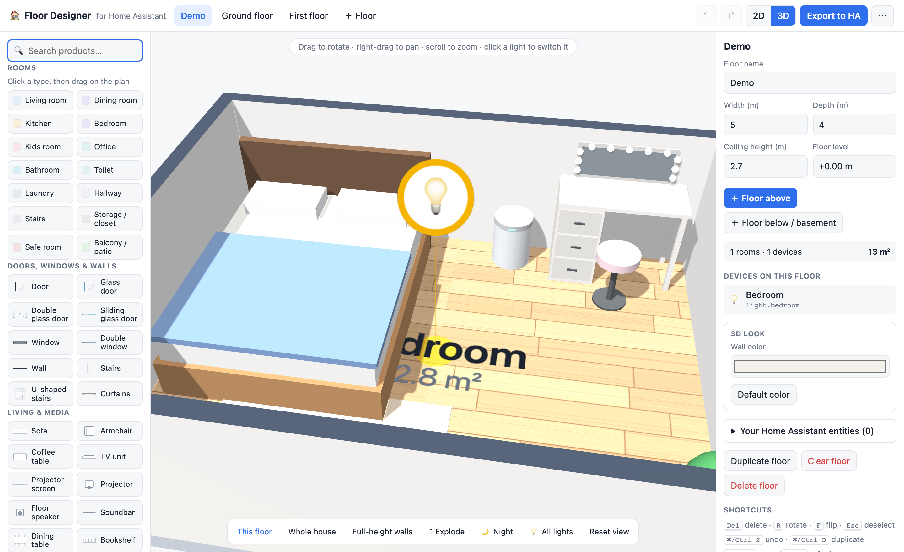 | 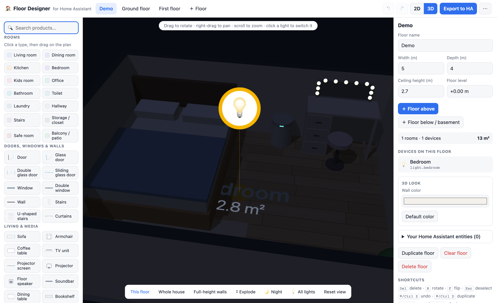 |

The full list of changes is in [CHANGELOG.md](CHANGELOG.md).

## What it does

- **Design your home.** Draw rooms, walls, doors, windows and stairs. Add any number of floors (and a basement), then furnish it from a catalog of sofas, beds, kitchens, plants, a makeup vanity, a sensor trash can and more. Use 🔍 search to find things fast.
- **Zoom in 2D.** Scroll or pinch to zoom, drag to move around, or use the − / + / Fit buttons.
- **Look around in 3D.** Drag to rotate, right-drag to pan and scroll to zoom. You can show one floor or the whole house, use full-height walls, or "explode" the floors apart.
- **Day or night.** 🌙 Night mode darkens the house so you can see which lights are on.
- **Control your devices.** Place lights, switches, ACs, shutters, TVs, sensors, cameras and more, and link each one to a Home Assistant entity.
  - Tap a light or switch to turn it on or off.
  - Tap anything else (AC, TV, shutter, sensor) to open Home Assistant's normal control window.
  - "All lights" switches every light on the floor at once.
- **Live.** Lights glow when they're really on, and the plan updates by itself when something changes in your home.
- **Saves to Home Assistant.** The design is stored in Home Assistant, so it's the same on your computer, phone and tablet.

| Night mode | 2D editor |
|---|---|
| 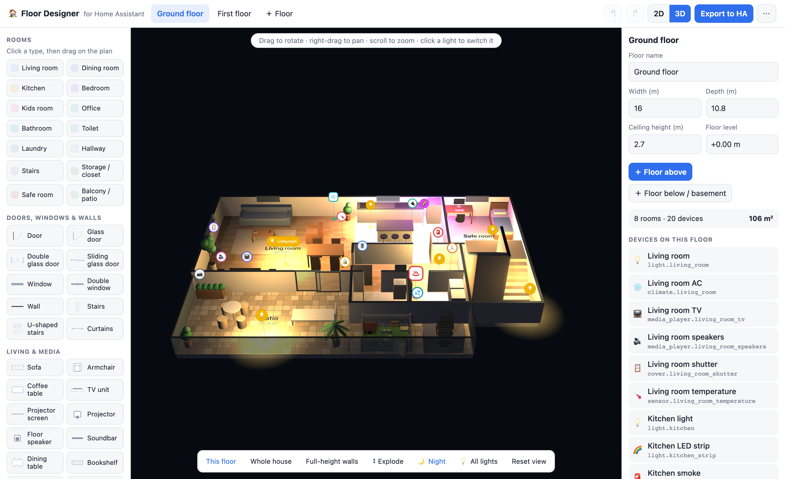 | 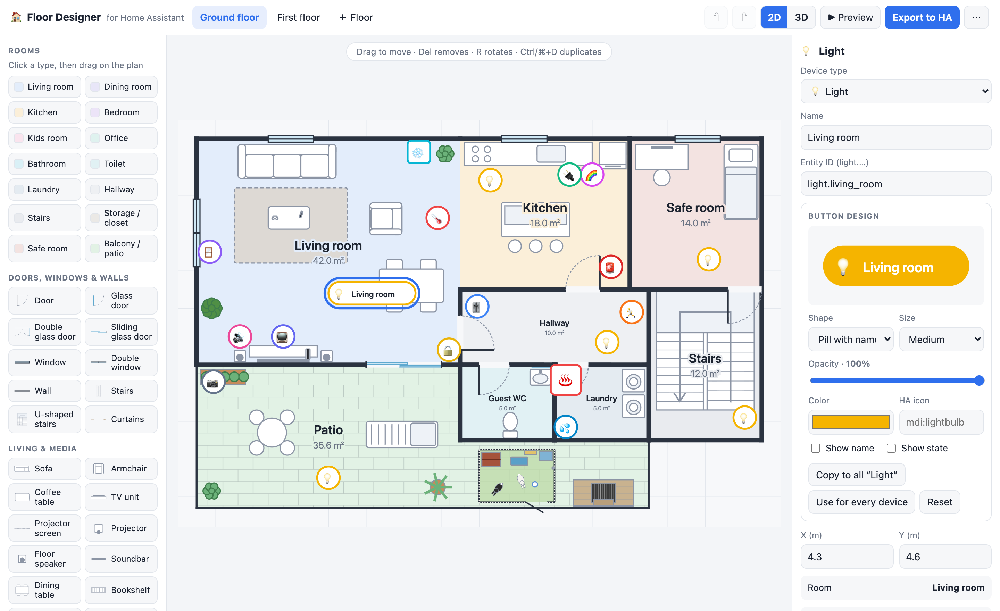 |

## Install with HACS (about 2 minutes)

[](https://my.home-assistant.io/redirect/hacs_repository/?owner=carmelbd&repository=ha-home-3d&category=plugin)

### 1. Download it in HACS

- **Easiest:** click the button above, choose your Home Assistant, then **Add** → **Download**.
- **Or by hand:** in Home Assistant open **HACS** → ⋮ (top right) → **Custom repositories**. Paste `https://github.com/carmelbd/ha-home-3d`, choose type **Dashboard**, and click **Add**. Then search HACS for **Home 3D** and click **Download**.

HACS adds the card to your dashboards automatically. If it asks you to reload the page, do it.

### 2. Add the Home 3D dashboard

1. Go to **Settings → Dashboards → + Add dashboard → New dashboard from scratch**. Name it **Home 3D** and pick an icon (`mdi:home-floor-3` looks nice).
2. Open the new dashboard, click ✏️ (top right) → ⋮ → **Raw configuration editor**, replace everything with this, and save:

```yaml
views:
  - title: Home 3D
    path: home
    type: panel
    cards:
      - type: custom:home-3d-card
```

3. Open **Home 3D** in the sidebar. That's it. It opens in **view mode**: drag to rotate, scroll or pinch to zoom, and tap a light to switch it. Tap **✏️ Edit** (top right) to change the design and **✓ Done** to go back.

The card is also in the normal **Add card** list, under the name **Home 3D**. It works best in a view of type **Panel (single card)**, which gives it the whole screen. In other views you can set its height, for example `height: 700px`.

<details>
<summary><b>Without HACS (manual install)</b></summary>

1. Download [`floor-designer.html`](floor-designer.html) and put it in the **`www`** folder inside your Home Assistant config folder (the folder with `configuration.yaml`). If there's no `www` folder, create it and restart Home Assistant once. You can use the *File editor* or *Samba* add-on, or Finder, Explorer or Cyberduck on a NAS.
2. Make the dashboard as in step 2 above, but use this card instead:

```yaml
      - type: iframe
        url: /local/floor-designer.html?v=1
```

To update later, replace the file and raise `?v=1` to `?v=2` so browsers and the phone app load the new copy.
</details>

### 3. Design your home

- Start from the example house with ⋯ → **Load example home**, or begin empty with ⋯ → **Start from empty floors**.
- Pick a device and type its entity in **Entity ID**. Your entities show up as suggestions while you type.
- Use **2D** to edit precisely and **3D** to look around. In 2D, **▶ Preview** lets you tap devices without moving them.

## Wall display (tablet on the wall)

Tap **⛶ Wall** (top right). The house fills the whole screen, covering Home Assistant's sidebar and top bar, and you can still rotate it and tap devices. Tap the screen three times to bring back the buttons, then **⚙ Wall settings** or **✕ Exit**.

In **⚙ Wall settings** you can choose:

- **The house:** 3D or 2D, whole house or one floor, cut-away or full-height walls. It can turn slowly by itself, and the night look can switch on after sunset. Room names and device buttons can be shown or hidden, and tapping a device can control it or do nothing (view only).
- **Clock:** digital, analog, small or none. Choose the position, size, 24 or 12 hour, seconds, date, color, and a frosted-glass card or plain text.
- **Weather:** a card with the temperature, today's high and low, "feels like", animated weather icons, a row per day with a temperature bar, and humidity, wind, sunrise and sunset. Choose **Colourful** (the background follows the weather and time of day) or **Like the clock card**, and now plus the next days, or now only. **Weather for:** where this tablet or phone is (its GPS when Home Assistant is opened over https, otherwise the location the Home Assistant app reports for you), your home, a chosen person or phone, or a Home Assistant weather entity. Location weather comes from [Open-Meteo](https://open-meteo.com), free and with no account; only a rounded location (about 1 km) is sent.
- **Info:** any values (for example `sensor.pool_temperature | Pool`) and a lights-on counter.
- **Scenes:** big buttons for scenes, scripts and buttons, one per line as `entity | label | emoji`. **＋ Add all my scenes & scripts** fills the list for you.
- **Cameras:** pictures that refresh every 2–30 seconds, in 4 sizes. Tap one to see it big. Pan-and-tilt cameras (Eufy Security or ONVIF) get ◀ ▲ ▼ ▶ arrows there to turn them. **＋ Add all my cameras** fills the list for you.
- **Positions:** every part has its own place (6 spots) or **Hidden**. **🧹 House only** hides everything at once, and **✨ Show clock, weather & info** brings it back.
- **Buttons:** show when you tap and then hide, stay hidden (tap 3 times), or always show.
- **Screensaver:** after 2–30 minutes, black with a slowly moving clock or a dimmed house. Tap to wake.

To open straight into the wall display, give the card `wall: true`:

```yaml
type: custom:home-3d-card
wall: true
```

**Tips for a wall tablet:** use the Home Assistant app and turn on its full-screen option, and set the tablet's Auto-Lock to **Never** (or use Guided Access on an iPad) so the screen stays on. Camera pictures are snapshots that refresh, not live video.

## Good to know

- **Saving needs an admin user.** Changes are saved into the dashboard itself, and Home Assistant only lets admins change dashboards. Other users can still view and control.
- **Backup or share a design:** ⋯ → **Save design file** / **Open design file**.
- **It needs internet** the first time it loads, because the 3D engine (three.js) and the photo textures (free CC0 textures from [Poly Haven](https://polyhaven.com)) are downloaded. Without internet it still works with simpler drawn textures.
- You can also open `floor-designer.html` on its own, outside Home Assistant, to play with a design. Devices are then simulated and the design is saved in that browser only.

## Updating to a new version

Your design is stored in Home Assistant, not in the plugin, so updating never touches it.

- **HACS:** when a new version is out, HACS shows an update under **Settings → Updates** (or in HACS). Click **Update**, then reload the page. On a phone, close and reopen the Home Assistant app.
- **Manual install:** see "Without HACS" above.
- **Moving from the manual install to HACS:** install with HACS, then in your existing Home 3D dashboard's raw configuration editor replace the `type: iframe` card (and its `url:` line) with `type: custom:home-3d-card`. Keep everything else, including the `floor_designer:` part, which is your design. You can then delete `floor-designer.html` from `www`.

## License

MIT. Use it, change it and share it.
